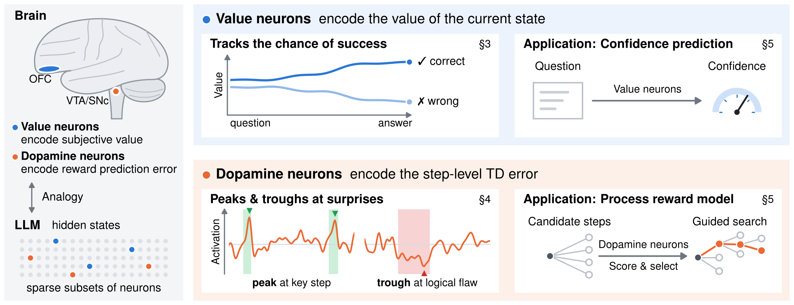

# Sparse Reward Subsystem in Large Language Models

[][#license-gh-package]
[](https://openreview.net/forum?id=3dZL4FURuU)
[][#arxiv-paper-package]

[#license-gh-package]: https://lbesson.mit-license.org/
[#arxiv-paper-package]: https://arxiv.org/abs/2602.00986

A reward subsystem inside LLMs!

We find sparse sets of neurons in LLM hidden states: **value neurons**, which encode how likely the model is to solve the current problem, and **dopamine neurons**, which encode the step-level reward prediction error (TD error) of each reasoning step.



## 📣 Updates

- **[October 2026]** The code for training value and dopamine probes and for reproducing the pruning curves is now released.

- **[September 2026]** Sparse Reward Subsystem is published at NeurIPS 2026. Check out our [paper](https://openreview.net/forum?id=3dZL4FURuU) for more details.

- **[February 2026]** Sparse Reward Subsystem is now released. Check out our [preprint](https://arxiv.org/abs/2602.00986) on arXiv.

## 🛠️ Installation

To set up the environment, please follow the steps below:

```bash
conda create -n reward_subsystem python=3.12 -y
conda activate reward_subsystem
pip install -r requirements.txt
pip install -e .
```

## 🚀 Motivating Example

In the brain, reward is processed by a small, specialised circuit: neurons in the orbitofrontal cortex encode the **subjective value** of the current state, and dopamine neurons in the VTA/SNc fire on **reward prediction errors**: a burst when things go better than expected, a dip when they go worse.

We ask whether RL-trained LLMs carry an analogous subsystem, and find that they do, in a very sparse form:

- **Value neurons.** A small *value probe*, trained with a temporal-difference (TD) loss on a model's hidden states, tracks the chance of success along a response.

- **Dopamine neurons.** Using Monte-Carlo rollouts, we estimate the value before and after every reasoning paragraph; the difference is the paragraph's TD error. A small *dopamine probe* on paragraph features predicts this error.

The two measurements behind these claims are the curves this repository reproduces: **AUC vs. pruning ratio** for the value probe, and **Spearman correlation vs. pruning ratio** for the dopamine probe.

## 💻 Code Usage

The pipeline has seven steps. Below we run it for `hkust-nlp/Qwen-2.5-7B-SimpleRL-Zoo` on MATH-500.

```bash
A=./artifacts
MODEL=hkust-nlp/Qwen-2.5-7B-SimpleRL-Zoo
OUT=$A/outputs/output_7B_simplerl_16000tk/math500/test_qwen-boxed_-1_seed0_t1.0_s0_e-1.jsonl
```

---

### 🔹 Step 1: Generate Responses

One vLLM response per problem (temperature 1.0, top-p 0.95, up to 16,000 new tokens), graded against the reference answer:

```bash
python scripts/01_generate_responses.py --model $MODEL --benchmark math500 \
    --output_dir $A/outputs/output_7B_simplerl_16000tk
```

---

### 🔹 Step 2: Train the Value Probe

An MLP (`hidden_size -> 1024 -> 1`) on the hidden states of one layer, trained with a TD loss toward the final reward:

```bash
python scripts/02_train_value_probe.py --model $MODEL --outputs_jsonl $OUT --benchmark math500 \
    --layer 3 --output_dir $A/value_probes/7B_simplerl_math500/layer_3
```

---

### 🔹 Steps 3–5: Train the Dopamine Probe

**TD errors.** From every paragraph boundary, 16 rollouts estimate the value `V(t)`; the TD error of a paragraph is `V(t+1) - V(t)`. This is the most expensive step:

```bash
python scripts/03_dopamine_td_errors.py --model $MODEL --outputs_jsonl $OUT --benchmark math500 \
    --result_dir $A/dopamine/td_dopamine_7B_simplerl_math500
```

**Paragraph features.** Hidden states of all layers, z-scored per response and averaged within each paragraph:

```bash
python scripts/04_dopamine_features.py --model $MODEL --outputs_jsonl $OUT --benchmark math500 \
    --result_dir $A/dopamine/td_dopamine_7B_simplerl_math500
```

**Dopamine probe.** An MLP (`hidden_size -> 32 -> 1`) regressing the TD error of paragraphs with `|delta| > 0.3`, one layer at a time:

```bash
for L in 20 21 22; do
  python scripts/05_train_dopamine_probe.py --layer $L \
      --result_dir $A/dopamine/td_dopamine_7B_simplerl_math500 \
      --output_dir $A/dopamine_probes/7B_simplerl_math500/layer$L
done
```

---

### 🔹 Step 6: Value Neurons: AUC vs. Pruning Ratio

`curve` prunes the value probe's input neurons at each ratio and computes the ROC-AUC of its question-only prediction (with a bootstrap error band); `plot` draws the figure:

```bash
for L in 2 3 4; do
  python scripts/06_plot_value_auc_vs_prune.py curve --model $MODEL --outputs_jsonl $OUT --benchmark math500 \
      --layer $L --probe $A/value_probes/7B_simplerl_math500/layer_$L/value_probe_best.pt \
      --output_json $A/value_auc/7B_simplerl_math500_layer$L.json
done
python scripts/06_plot_value_auc_vs_prune.py plot --output $A/figures/value_auc_7B.pdf \
    --panel "MATH 500" "Layer 2=$A/value_auc/7B_simplerl_math500_layer2.json" \
                       "Layer 3=$A/value_auc/7B_simplerl_math500_layer3.json" \
                       "Layer 4=$A/value_auc/7B_simplerl_math500_layer4.json"
```

---

### 🔹 Step 7: Dopamine Neurons: Spearman vs. Pruning Ratio

`curve` computes the Spearman correlation between the pruned dopamine probe's prediction and the TD error on held-out problems (CPU, seconds); `plot` draws the figure:

```bash
D=$A/dopamine_probes/7B_simplerl_math500
for L in 20 21 22; do
  python scripts/07_plot_dopamine_spearman_vs_prune.py curve \
      --result_dir $A/dopamine/td_dopamine_7B_simplerl_math500 --probe_dir $D/layer$L \
      --output_json $D/layer$L/spearman_curve.json
done
python scripts/07_plot_dopamine_spearman_vs_prune.py plot --output $A/figures/dopamine_spearman.pdf \
    --panel "Qwen2.5-7B-RL" "Layer 20=$D/layer20/spearman_curve.json" \
                            "Layer 21=$D/layer21/spearman_curve.json" "Layer 22=$D/layer22/spearman_curve.json"
```

---

### 🧩 Reproducing the Paper's Figures

You can reproduce figures by changing `--model`, `--benchmark` and `--layer`.
Available benchmarks: `math500`, `gsm8k`, `arc`.

## 📝 Resources

### Inspiration

Many existing works greatly inspired this project! Here is a non-exhaustive list:

- 📚 [**SimpleRL-Zoo**](https://github.com/hkust-nlp/simpleRL-reason) — the RL-trained Qwen2.5 models we study.
- 📚 [**Qwen2.5-Math**](https://github.com/QwenLM/Qwen2.5-Math) — the evaluation toolkit.
- 📚 [**vLLM**](https://github.com/vllm-project/vllm) — fast generation for responses and Monte-Carlo rollouts.

### Citation

```bibtex
@misc{xu2026sparserewardsubsystemlarge,
      title={Sparse Reward Subsystem in Large Language Models}, 
      author={Guowei Xu and Mert Yuksekgonul and James Zou},
      year={2026},
      eprint={2602.00986},
      archivePrefix={arXiv},
      primaryClass={cs.CL},
      url={https://arxiv.org/abs/2602.00986}, 
}
```

